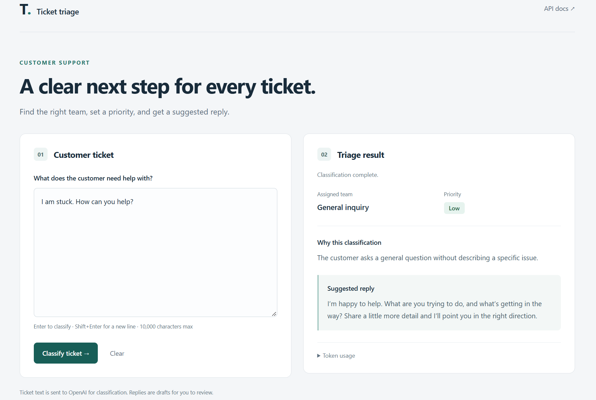

# AI Customer Support Ticket Triage

Local customer support ticket triage application with a FastAPI backend. Enter a ticket in the browser to get
an assigned team, priority, explanation, and suggested reply, with token usage
available in an expandable section.

Requires an OpenAI API key. The current development environment
uses Python 3.13. All commands below use Windows PowerShell from the project
directory.

## Setup

Create a virtual environment if you do not already have one, then install the
dependencies:

```powershell
python -m venv .venv
.\.venv\Scripts\python.exe -m pip install -r requirements.txt
```

Create `.env` as a copy of `.env.example`.
Edit `.env` and set your key:

```dotenv
OPENAI_API_KEY=your_api_key_here
```

The classifier loads this file using `python-dotenv`.

## Run the web UI

```powershell
.\.venv\Scripts\python.exe -m uvicorn main:app --reload
```

Open **http://127.0.0.1:8000**.

1. Enter a customer support ticket, for example:
   "I was charged twice for my subscription."
2. Press **Enter** or click **Classify ticket**. Use **Shift+Enter** for a new line.
3. Review the assigned team, priority, explanation, and suggested reply.
4. Expand **Token usage** to see input, output, and total tokens, or click
   **Clear** to reset the form.

Each classification sends the ticket text to OpenAI and uses API tokens (the model called is `gpt-6-luna`).
Replies are drafts for a support agent to review. Restart the server after
changing `.env`; stop it with **Ctrl+C**.



## Evaluation

Run the evaluation module from the project directory:

```powershell
.\.venv\Scripts\python.exe -m app.evaluate data/eval_set.json
```

Evaluation calls the classifier directly and does not require the web server.
It makes real OpenAI API calls for each ticket. The bundled dataset contains
37 labelled tickets covering all four teams and all four priorities. Each
dataset entry must contain `id`, `text`, `expected_team`, and `expected_priority`.

The report includes team accuracy, priority accuracy,
joint accuracy, request failures, and critical-ticket recall. Failed requests
count as incorrect classifications.

Initial evaluation targets:

- At least 20 manually labelled tickets covering every team and priority.
- At least 85% team accuracy and 85% priority accuracy.
- No missed critical tickets in the evaluation dataset.

These are targets, not a claim about current accuracy. A small dataset does not
establish reliability across all customer tickets.
